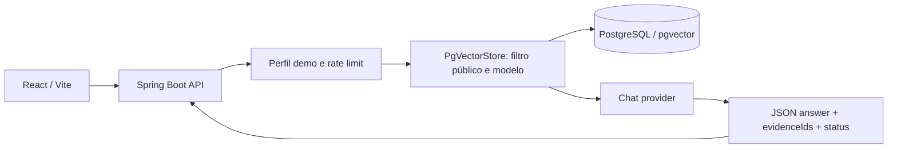

# EvidenceRAG

Demo de RAG documental: indexa PDF pesquisável e Markdown, recupera trechos com pgvector e só devolve resposta quando o modelo aponta IDs presentes na recuperação. O backend monta metadados e excertos a partir do banco; o modelo não cria citações. O resultado ainda exige revisão humana.

## Estado

- Backend: Java 21, Spring Boot 4.2.0, Spring AI 2.1.0, PostgreSQL 17 + pgvector.
- Frontend: React 19, TypeScript 5.9, Vite 7 e Vitest 5.
- Providers configuráveis e independentes: Ollama, OpenAI e Google GenAI (Gemini). Chat e embeddings precisam usar configurações/modelos compatíveis com a dimensão e com os vetores já indexados.
- Perfil local mantém upload, listagem e exclusão. Perfil Spring `demo` remove esses endpoints e aceita perguntas só sobre registros marcados `visibility=public-demo` e embeddings do modelo configurado.
- O corpus público em [`docs/demo-corpus`](docs/demo-corpus) é fictício. Não indexe currículo, documentos pessoais, documentos de cliente ou material corporativo.
- Render/Neon estão preparados em [`render.yaml`](render.yaml) e [`docs/deploy-render-neon-gemini.md`](docs/deploy-render-neon-gemini.md), sem serviços criados, deploy ou migração remota.

## Arquitetura



Camadas do backend: `api`, `application`, `domain` e `infrastructure`. Extração/chunking e chamadas de embedding acontecem antes da transação; a gravação do catálogo e dos vetores pré-calculados é transacional. Flyway mantém migrações incrementais: V1 catálogo/vetores, V2 dimensão HNSW e V3 offsets de origem. A dimensão padrão é 768; trocar de família/modelo exige reindexação completa.

## Testar localmente no Windows

Pré-requisitos: JDK 21, Maven, Node.js 22+ e Docker Desktop com Compose. Para Ollama instalado no host, modelos de chat e embeddings devem estar baixados; Compose usa `host.docker.internal`.

1. Copie o exemplo só se ainda não houver configuração local:

```powershell
if (-not (Test-Path .env)) { Copy-Item .env.example .env }
```

2. Para manter o banco de demonstração isolado de qualquer stack local preexistente, use nome de projeto e portas exclusivos. Isso cria volume Compose próprio:

```powershell
$env:DB_HOST_PORT = "55432"
$env:API_HOST_PORT = "18080"
$env:WEB_HOST_PORT = "15173"
$env:APP_CORS_ORIGIN = "http://localhost:15173"
$env:VITE_API_BASE_URL = "http://localhost:18080"
docker compose -p evidencerag-demo -f compose.yml --env-file .env config --quiet
docker compose -p evidencerag-demo -f compose.yml --env-file .env up --build
```

3. Abra `http://localhost:15173`; API/health em `http://localhost:18080/actuator/health`. No modo local, adicione um dos documentos fictícios em `sample-documents/` ou `docs/demo-corpus/` e faça uma pergunta. Com `APP_API_TOKEN`, informe esse token na interface local. A API pública usa o perfil `demo` e o frontend de produção não contém token.

4. Pare a stack pelo terminal com `Ctrl+C`, ou execute `docker compose -p evidencerag-demo -f compose.yml --env-file .env down`. Não use `down -v` se quiser preservar o volume de teste.

Para iniciar sem Compose, veja [`docs/api.md`](docs/api.md) e configure `DATABASE_URL`, providers e dimensões antes de `mvn -f backend/pom.xml spring-boot:run`. O projeto ainda não inclui Maven Wrapper.

## Providers

- **Ollama local:** `CHAT_PROVIDER=ollama`, `EMBEDDING_PROVIDER=ollama`, `OLLAMA_CHAT_MODEL`, `OLLAMA_EMBEDDING_MODEL`, `OLLAMA_BASE_URL` e `APP_EMBEDDING_DIMENSIONS`.
- **Gemini:** `CHAT_PROVIDER=google-genai`, `EMBEDDING_PROVIDER=google-genai`, `GEMINI_API_KEY`, `GEMINI_CHAT_MODEL`, `GEMINI_EMBEDDING_MODEL` e `APP_EMBEDDING_DIMENSIONS`. O valor de 768 para `gemini-embedding-001` reduz o vetor; confirme modelo/cota disponíveis no AI Studio. O nível gratuito pode usar conteúdo enviado para aprimorar produtos: só utilize material fictício.
- **OpenAI:** `CHAT_PROVIDER=openai`, `EMBEDDING_PROVIDER=openai`, `OPENAI_API_KEY`, `OPENAI_CHAT_MODEL`, `OPENAI_EMBEDDING_MODEL` e dimensão correspondente.

Os nomes estão exemplificados em [`.env.example`](.env.example); mantenha valores reais apenas em secret store/painel privado. Nunca use uma variável `VITE_*` para chave, senha ou token.

Cada embedding novo é marcado automaticamente com `provedor:modelo` ativo (por exemplo, `google-genai:gemini-embedding-001`) e a busca filtra essa identidade. A busca também mantém compatibilidade com vetores legados sem namespace do mesmo modelo ativo. Ao trocar o provider/modelo, vetores de outros espaços continuam no banco e não entram na busca.

## Verificações

```powershell
mvn -f backend/pom.xml test
Push-Location frontend
npm ci
npm test
npm run typecheck
npm run lint
npm run build
Pop-Location
python scripts/evaluate_corpus.py
```

O baseline avalia lexicalmente 25 perguntas fictícias e não mede qualidade semântica, embeddings, segurança do LLM ou precisão real do RAG. Consulte o relatório desta execução em [`docs/validation-report.md`](docs/validation-report.md).

## Publicação futura

1. Revise e publique primeiro o repositório no GitHub. Verifique `.env`, segredos, documentos e build antes do push.
2. Confirme que a base Neon designada contém somente corpus fictício. Configure runtime com URL pooler e migração com URL direta/TLS.
3. Revise/aplique V2/V3 manualmente no Neon; esta missão não migrou banco remoto.
4. Configure `APP_CORS_ORIGIN`, `GEMINI_API_KEY` e variáveis privadas no Render. Revise o Blueprint e só então sincronize/deploye manualmente.

Veja o [guia Render + Neon + Gemini](docs/deploy-render-neon-gemini.md) e [limites de segurança](docs/security.md). Esta demo tem rate limit/concurrency em memória, uma instância pública e cold starts; não é uma plataforma multiusuário ou sistema de produção para documentos privados.
