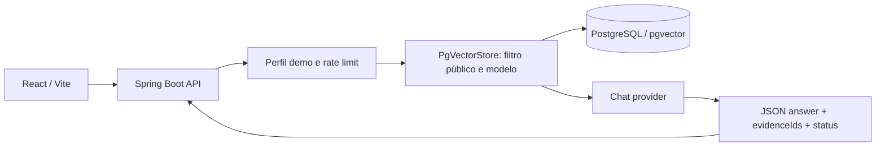

# EvidenceRAG

Demo de RAG documental: indexa PDF pesquisável e Markdown, recupera trechos com pgvector e só devolve resposta quando o modelo aponta IDs presentes na recuperação. O backend monta metadados e excertos a partir do banco; o modelo não cria citações. O resultado ainda exige revisão humana.

## EvidenceRAG — Interactive AI Engineering Demo

A edição de portfólio é um frontend estático, sem backend, sessão, cookie ou chamada a Groq/Gemini/Ollama. Ela reproduz três execuções registradas com dados fictícios e identifica cada uma como `AI_TOOL_LOOP` ou `DETERMINISTIC_FALLBACK`; os cenários determinísticos permanecem rotulados como tais. A página pública informa que nenhuma chamada ao modelo ocorre durante a demonstração e apresenta as ferramentas, referências, latência e tokens somente onde esses dados foram registrados.

```powershell
Push-Location frontend
npm ci
npm run build            # frontend/dist para hospedagem estática, base /
npm run build:pages    # frontend/dist para GitHub Pages, base /evidencerag/
Pop-Location
```

`npm run dev` abre o modo de desenvolvimento Banking AI real (proxy `/api` para Spring Boot). `npm run dev:rag` abre a aplicação RAG original. `npm run build:live` cria uma build local conectada ao backend. A imagem frontend do Compose usa por padrão a build estática de portfólio; o backend e o PostgreSQL locais continuam disponíveis sem serem requisitados pelo portfólio. A hospedagem pública ainda não foi configurada nem publicada.

Para configurar o deploy depois da revisão, crie no Render um **Static Site** com repositório `dhionson2/evidencerag`, branch `evo/portfolio-static-demo`, Root Directory `frontend`, Build Command `npm run build` e Publish Directory `dist`. Essa build usa `base: '/'`. Não configure variáveis de ambiente, API keys, backend ou banco para o site estático. Nenhum serviço foi criado ou publicado nesta preparação.

Detalhes de proveniência, limitações e critérios da demo estão em [`docs/portfolio-static-demo.md`](docs/portfolio-static-demo.md). O design do sistema real segue em [`docs/architecture.md`](docs/architecture.md) e [`docs/banking-demo-sdd.md`](docs/banking-demo-sdd.md).

## Estado

- Backend: Java 21, Spring Boot 4.2.0, Spring AI 2.1.0, PostgreSQL 17 + pgvector.
- Frontend: React 19, TypeScript 5.9, Vite 7 e Vitest 5.
- Providers configuráveis e independentes: Ollama, OpenAI, Groq (API compatível com OpenAI) e Google GenAI (Gemini). Chat e embeddings são configurados separadamente; a integração Groq é somente para chat e não altera os embeddings nem a dimensão dos vetores existentes.
- O portfólio público preparado é estático e reproduz três execuções documentadas sem chamadas a provedores. O Banking AI conectado continua como modo de desenvolvimento; o código Analista permanece preservado e desativado por flags no modo local configurado para o MVP Cliente.
- Perfil local mantém upload, listagem e exclusão. Perfil Spring `demo` remove esses endpoints e aceita perguntas só sobre registros marcados `visibility=public-demo` e embeddings do modelo configurado.
- O corpus público em [`docs/demo-corpus`](docs/demo-corpus) é fictício. Não indexe currículo, documentos pessoais, documentos de cliente ou material corporativo.
- Para hospedar esta edição estática, siga as configurações manuais em [`docs/portfolio-static-demo.md`](docs/portfolio-static-demo.md). Esta branch não inclui manifesto de serviço do Render nem publica backend ou Neon.

## Arquitetura



Camadas do backend: `api`, `application`, `domain` e `infrastructure`. Extração/chunking e chamadas de embedding acontecem antes da transação; a gravação do catálogo e dos vetores pré-calculados é transacional. Flyway mantém migrações incrementais: V1 catálogo/vetores, V2 dimensão HNSW e V3 offsets de origem. A dimensão padrão é 768; trocar de família/modelo exige reindexação completa.

## Testar localmente no Windows

Pré-requisitos: JDK 21, Maven, Node.js 22+ e Docker Desktop com Compose. Para Ollama instalado no host, modelos de chat e embeddings devem estar baixados; Compose usa `host.docker.internal`.

1. Copie o exemplo só se ainda não houver configuração local:

```powershell
if (-not (Test-Path .env)) { Copy-Item .env.example .env }
```

2. Para manter o banco de demonstração isolado de qualquer stack local preexistente, use nome de projeto e portas exclusivos. Isso cria volume Compose próprio:

```powershell
$env:DB_HOST_PORT = "55432"
$env:API_HOST_PORT = "18080"
$env:WEB_HOST_PORT = "15173"
$env:APP_CORS_ORIGIN = "http://localhost:15173"
$env:VITE_API_BASE_URL = "http://localhost:18080"
docker compose -p evidencerag-demo -f compose.yml --env-file .env config --quiet
docker compose -p evidencerag-demo -f compose.yml --env-file .env up --build
```

3. Abra `http://localhost:15173`; API/health em `http://localhost:18080/actuator/health`. No modo local, adicione um dos documentos fictícios em `sample-documents/` ou `docs/demo-corpus/` e faça uma pergunta. Com `APP_API_TOKEN`, informe esse token na interface local. A API pública usa o perfil `demo` e o frontend de produção não contém token.

4. Pare a stack pelo terminal com `Ctrl+C`, ou execute `docker compose -p evidencerag-demo -f compose.yml --env-file .env down`. Não use `down -v` se quiser preservar o volume de teste.

Para iniciar sem Compose, veja [`docs/api.md`](docs/api.md) e configure `DATABASE_URL`, providers e dimensões antes de `mvn -f backend/pom.xml spring-boot:run`. O projeto ainda não inclui Maven Wrapper.

## Providers

- **Ollama local:** `CHAT_PROVIDER=ollama`, `EMBEDDING_PROVIDER=ollama`, `OLLAMA_CHAT_MODEL`, `OLLAMA_EMBEDDING_MODEL`, `OLLAMA_BASE_URL` e `APP_EMBEDDING_DIMENSIONS`.
- **Gemini:** `CHAT_PROVIDER=google-genai`, `EMBEDDING_PROVIDER=google-genai`, `GEMINI_API_KEY`, `GEMINI_CHAT_MODEL`, `GEMINI_EMBEDDING_MODEL` e `APP_EMBEDDING_DIMENSIONS`. O valor de 768 para `gemini-embedding-001` reduz o vetor; confirme modelo/cota disponíveis no AI Studio. O nível gratuito pode usar conteúdo enviado para aprimorar produtos: só utilize material fictício.
- **OpenAI:** `CHAT_PROVIDER=openai`, `EMBEDDING_PROVIDER=openai`, `OPENAI_API_KEY`, `OPENAI_CHAT_MODEL`, `OPENAI_EMBEDDING_MODEL` e dimensão correspondente.
- **GroqCloud (somente chat):** `CHAT_PROVIDER=groq`, `SPRING_AI_MODEL_CHAT=openai`, `GROQ_API_KEY`, `GROQ_BASE_URL=https://api.groq.com/openai/v1` e `GROQ_CHAT_MODEL=openai/gpt-oss-20b`. O Spring AI 2.1 usa seu adaptador OpenAI-compatible (`spring.ai.model.chat=openai`) por baixo; a aplicação continua identificando o provider como `groq`. Mantenha a chave em `.env` ignorado pelo Git ou em um secret manager. Não use a chave Groq como chave de embeddings.

No preview Banking AI, Groq envia tool definitions ao modelo e o backend executa as ferramentas Java autorizadas; cada rodada de ferramenta volta ao modelo para a resposta final. Os limites locais são 8.000 tokens/minuto por instância, uma interação de IA concorrente, 20 interações por sessão, quatro chamadas de ferramenta, 600 tokens de saída, contexto de 12 mensagens/8.000 caracteres e timeout de 30 segundos. O cliente OpenAI-compatible não faz retries automáticos; somente `tool_use_failed` recebe uma nova tentativa limitada, em temperatura zero e contada no mesmo orçamento. 429 é informado explicitamente e não inicia troca automática de provedor. `openai/gpt-oss-20b` não usa chamadas paralelas neste fluxo. A estimativa anual é recusada como insuficiência quando o ledger não cobre 12 meses; nenhuma extrapolação de amostra parcial é apresentada como valor preciso. Esta configuração não habilita faturamento.

Os nomes estão exemplificados em [`.env.example`](.env.example); mantenha valores reais apenas em secret store/painel privado. Nunca use uma variável `VITE_*` para chave, senha ou token.

Cada embedding novo é marcado automaticamente com `provedor:modelo` ativo (por exemplo, `google-genai:gemini-embedding-001`) e a busca filtra essa identidade. A busca também mantém compatibilidade com vetores legados sem namespace do mesmo modelo ativo. Ao trocar o provider/modelo, vetores de outros espaços continuam no banco e não entram na busca.

## Banking AI — etapas locais 1–3

O sandbox bancário usa dados exclusivamente sintéticos, sessões anônimas isoladas e TTL absoluto de quatro horas. Em desenvolvimento, habilite `VITE_BANKING_DEMO=true`; Vite encaminha `/api` para o backend na mesma origem e `BANK_DEMO_COOKIE_SECURE=false` em HTTP local (`true` em HTTPS). As experiências Cliente e Funcionário/Analista usam um assistente conversacional único, que escolhe ferramentas permitidas de acordo com o contexto imposto pelo servidor. O Cliente consulta saldo, movimentações, despesas e alertas; o Analista consulta alertas, propostas e políticas e pode pedir análise cruzada SC-05. O parecer apresenta fatos, fontes, interpretação, lacunas e recomendação para revisão humana; nunca decide crédito ou fraude. O histórico é separado por sessão e por contexto.

As ferramentas Java leem somente a sessão validada pelo backend. O ranking de despesas cobre as seis movimentações mais recentes exibidas no painel, filtra débitos e calcula os valores no servidor; totais categorizados consultam os registros da categoria. As políticas banking são recuperadas por PostgreSQL full-text com versão e seção; essa busca não utiliza um índice vetorial dedicado e não substitui o vector store do EvidenceRAG original. O histórico conversacional usa migration V6. O SDD com migrações/limites está em [`docs/banking-demo-sdd.md`](docs/banking-demo-sdd.md).

Esta branch prepara somente a edição de portfólio estática. Configure-a manualmente como Static Site conforme [`docs/portfolio-static-demo.md`](docs/portfolio-static-demo.md); nenhum serviço ou deploy foi criado. O manifesto Docker da API foi removido desta branch para evitar selecionar o tipo de serviço errado.

## Verificações

```powershell
mvn -f backend/pom.xml test
Push-Location frontend
npm ci
npm test
npm run typecheck
npm run lint
npm run build
Pop-Location
python scripts/evaluate_corpus.py
```

O baseline avalia lexicalmente 25 perguntas fictícias e não mede qualidade semântica, embeddings, segurança do LLM ou precisão real do RAG. Consulte o relatório desta execução em [`docs/validation-report.md`](docs/validation-report.md).

## Publicação futura

1. Revise e publique primeiro o repositório no GitHub. Verifique `.env`, segredos, documentos e build antes do push.
2. Confirme que a base Neon designada contém somente corpus fictício. Configure runtime com URL pooler e migração com URL direta/TLS.
3. Revise/aplique V1–V6 somente em Neon dedicado à demo; esta execução não migrou banco remoto.
4. Configure `APP_CORS_ORIGIN`, `GEMINI_API_KEY` e variáveis privadas no Render. Revise o Blueprint e só então sincronize/deploye manualmente.

Para contexto do backend original, veja o [guia Render + Neon + Gemini](docs/deploy-render-neon-gemini.md) e [limites de segurança](docs/security.md). Esta edição de portfólio é estática e reproduz cenários registrados; não é uma plataforma multiusuário nem um sistema de produção para documentos privados.
