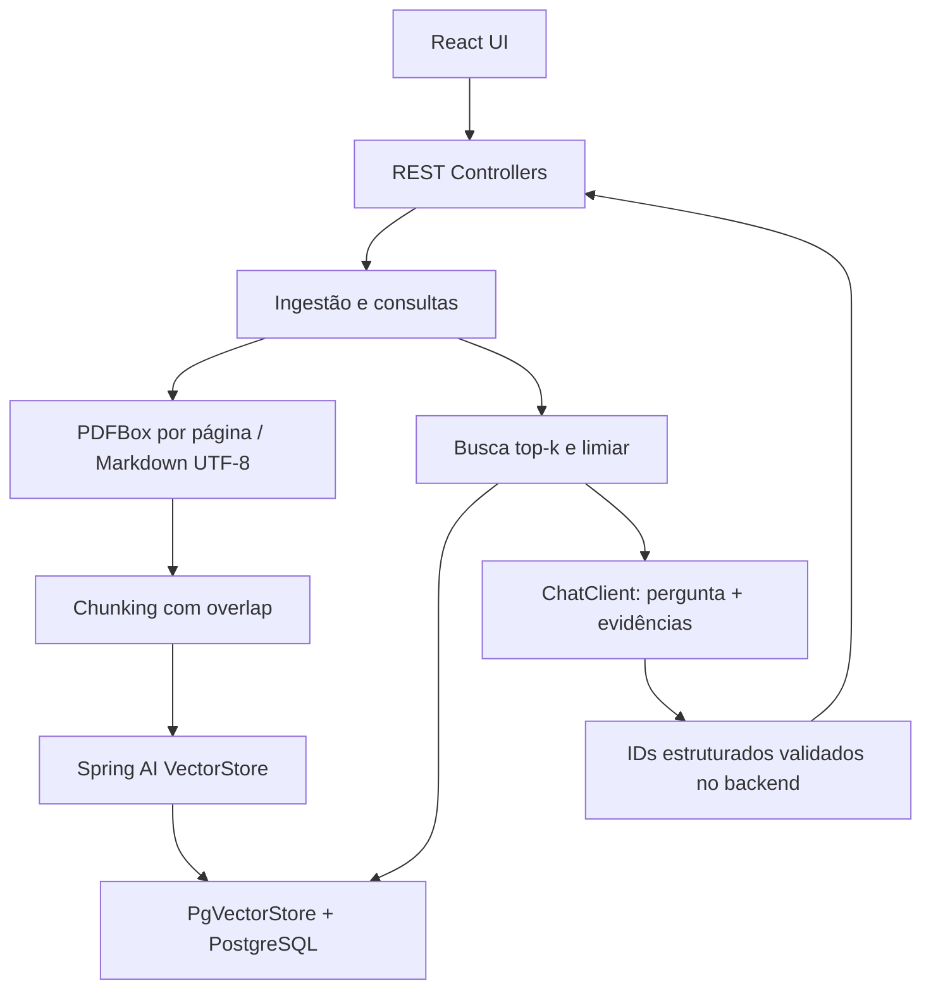

# Arquitetura

## Caminho de ingestão

Upload multipart → extensão/MIME/tamanho/assinatura PDF → hash SHA-256 → extração com limite → chunking por página → embeddings fora da transação SQL → catálogo relacional e `VectorStore.upsert` com vetores pré-calculados numa transação única. O hash de conteúdo permite upload repetido idempotente. Ao excluir, IDs vetoriais são consultados no catálogo para remover os vetores e, em seguida, o catálogo é excluído.

## Consulta

A API valida a pergunta → `VectorStore.similaritySearch` gera o embedding da consulta e recupera top-k com threshold → o filtro exige a identidade `provedor:modelo` gravada na ingestão (e também `visibility=public-demo` no perfil `demo`) → se vazio, responde `INSUFFICIENT_EVIDENCE` sem chat completion → serializa evidências como JSON de dados não confiáveis → ChatClient retorna JSON estruturado (`answer`, `evidenceIds`, `status`) → `CitationValidationService` resolve IDs exclusivamente entre os trechos recuperados → só então a API devolve resposta `GROUNDED` e metadados/excertos do banco.

O threshold de similaridade precisa de calibração com corpus e embeddings reais. Ele é uma configuração, não uma prova matemática de suporte factual.

## Persistência

Flyway V1 cria a tabela com vetor sem dimensão fixa e não cria índice vetorial. V2 fixa a dimensão informada por `APP_EMBEDDING_DIMENSIONS` e cria HNSW cosine. O valor padrão escolhido é 768: compatível com `nomic-embed-text` local e configurável para `gemini-embedding-001`; confirme o retorno do provedor antes de indexar. Os metadados novos usam identidade namespaced como `ollama:nomic-embed-text` ou `google-genai:gemini-embedding-001`, derivada do provider/modelo ativo. A busca também aceita o identificador legado sem namespace do modelo ativo, preservando vetores antigos compatíveis; embeddings identificados como outro modelo ficam fora da busca sem serem removidos. A migração é somente localmente validada nesta missão e precisa ser executada manualmente no Neon após backup/revisão. Trocar o provider/modelo exige reindexar o corpus que se deseja consultar naquele espaço; a dimensão igual não significa espaço vetorial compatível.

## Perfil público

O perfil Spring `demo` remove `DocumentController` do contexto e força consultas a procurar somente metadados `public-demo` indexados pelo embedding configurado. A API não lista corpus nem expõe metadados por ID fornecido pelo visitante. A carga fictícia deve ser preparada numa base dedicada vazia antes de ativar o perfil, usando o modo local/admin com `APP_DOCUMENT_VISIBILITY=public-demo`; nunca migre documentos pessoais para esse corpus.
